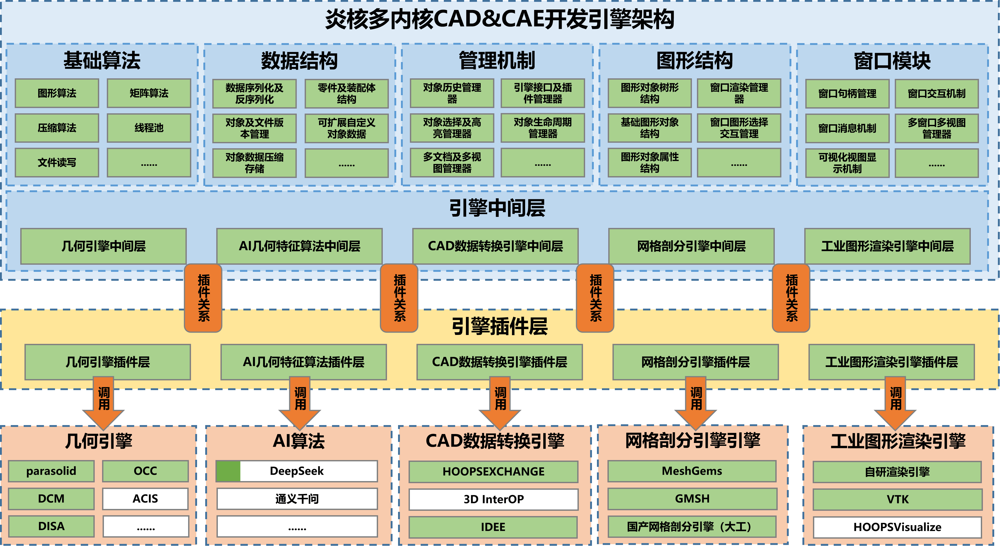

# YHCAEPre 通用多内核开发引擎

欢迎使用 **YHCAEPre（炎核通用多内核开发引擎，General Multi‑kernel Development Engine）**。  
**炎核多内核CAD/CAE开发平台**，解决用户研发CAD/CAE软件从0到1的难题，极具扩展性的系统架构可以让用户在内核筛选上有自主可控的选择权，现有非常丰富的几何、渲染或CAD/CAE基础功能可以复用，整个解决方案可以减少巨大的人力成本和时间成本。

YHCAEPre 提供 **两种语言版本**，可按需选用：

| 版本 | 适用场景 |
|---|---|
| 🐍 **PyCAEPre（Python）** | 脚本化、自动化、算法验证、快速原型 |
| 🧩 **CppCAEPre（C++）** | 高性能计算、大型工程、桌面应用 |

---
## 一、开发引擎架构



---

## 二、代码结构
```shell
+---doc                                 #文档资料
+---CppCAEPre                           # C++ CAD&CAE应用软件开源源码
|   +---3rdparty                        #第三方库
|   +---cmake                           # cmake函数文件
|   +---examples                        #开发示例项目
|   |   +---ncti_cmd_demo               #命令工程示例
|   |   +---ncti_occ_plugin_demo        # OCC插件工程示例
|   |   +---ncti_plugin_demo            #插件中间层示例
|   |   \---ncti_python_demo            # Python接口集成示例
|   \---NctiCAEPre                      #开源源码
|       +---Code                        # cpp文件
|       |   +---ncti_qt_cae_pre         # exe启动项目
|       |   +---ncti_qt_launcher        #多文档启动项目
|       |   +---ncti_qt_pubfun          #公用函数项目
|       |   +---ncti_qt_script_edit     #脚本编辑器项目
|       |   \---ncti_qt_uioption        # UI设计项目
|       \---Inc                         #项目头文件
|           +---ncti_qt_launcher
|           +---ncti_qt_pubfun
|           +---ncti_qt_script_edit
|           \---ncti_qt_uioption
+---PyCAEPre                            # Python CAD&CAE应用软件开源源码
|   +---Function                        #菜单栏功能函数
|   +---Pub                             #公用函数、配置文件
|   +---resources                       #图标资源
|   +---sample                          #简单样例
|   +---scripts                         #脚本功能接口方法
|   \---View                            #视图与对话框
\---SDK                                 # SDK工具开发包
    +---bin                             #动态链接库目录
    |   \---RelWithDebInfo              
    +---inc                             #依赖库头文件
    \---lib                             #静态链接库
```

## 三、平台底层支持

- ✅ 支持16+个内核，涵盖5类，包括开源、国产和商业内核 
- ✅ 开发平台核心代码完全自研，提供1000多个C++接口和800多个python接口
- ✅ 支持window10及以上，centos、ubuntu操作系统，支持x64、ARM芯片
- ✅ 支持超大规模1亿+粒子流畅显示，可实现1亿+粒子3秒内快速划分，性能指标达到国际商软水平
- ✅ 支持万级装配零部件的流畅显示，支持并行计算读写万级装配零部件
- ✅ 支持C++14及以上，支持python3.8及以上，支持gcc/g++8.20及以上，支持任意UI框架
- ✅ 支持Python轻量化开发，C++深度定制，TS/JS 快速构建等多种语言开发

## 四、功能特性

- ✅ 几何 / 数据转换 / 约束 / 网格 /图形渲染多内核集成  
- ✅ CAD几何建模 / CAE前处理 / 网格剖分 全流程支持  
- ✅ Python / C++ 双语言版本开发  
- ✅ 插件化架构，易于扩展  
- ✅ Python版低门槛灵活定制，快速构建专属软件
- ✅ C++版深度定制，开发复杂交互的CAD&CAE前处理软件
- ✅ 官网提供完整 API 与示例  

---

## 五、许可说明

| 组件 | 许可类型 |
|---|---|
| **PyCAEPre / CppCAEPre 源码** | 木兰宽松许可证 v2（开源） |
| **SDK 开发包** | 个人免费非商业许可 |
| **商业使用** | 需向国创中心单独申请 |

详细许可条款请参见：  
[《炎核多内核CAD&CAE开发平台社区版软件许可协议》](doc/炎核多内核CAD&CAE开发平台社区版软件许可协议.docx)

---

## 六、获取授权

SDK 使用前需获取授权凭证（`gmde.lic`）：

1. 访问 **炎核官方网站（https://opencax.cn/）**
2. 使用官网工具获取 **机器码**
3. 提交非商业使用申请
4. 下载并放置 `gmde.lic` 至程序运行目录（SDK/bin/RelWithDebInfo）

> 开源源码（PyCAEPre / CppCAEPre）无需授权。

---

## 七、使用说明

| 你想做什么 | 请看这里 |
|---|---|
| 使用 Python 开发 | 👉 [PyCAEPre/README.md](PyCAEPre/README.md) |
| 使用 C++ 开发 | 👉 [CppCAEPre/README.md](CppCAEPre/README.md) |
| 了解第三方依赖 | 📄 [doc/THIRD-PARTY-NOTICES](doc/THIRD-PARTY-NOTICES.docx) |

---

## 八、开发课程与技术支持

1. 开发课程可访问在线开发教程：[https://opencax.cn/gmde/knowledge/index](https://opencax.cn/gmde/knowledge/index)。该教程平台汇集相关开发入门指引、接口调用示例、实战案例以及常见问题解答等内容，覆盖从基础上手到二次开发的学习资料，开发者可在线查阅学习，快速掌握平台开发能力。
2. 如有问题或建议，可通过炎核官方网站（https://opencax.cn/gmde/contactus） 或支持邮箱（support@opencax.cn）反馈。

