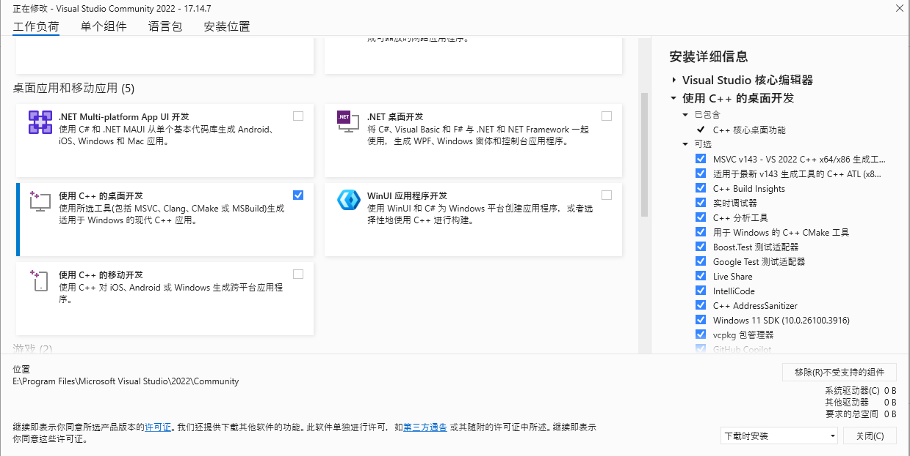
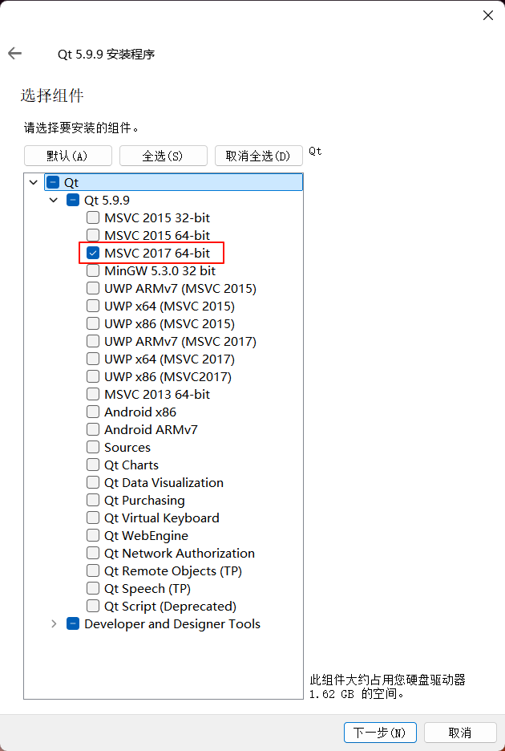
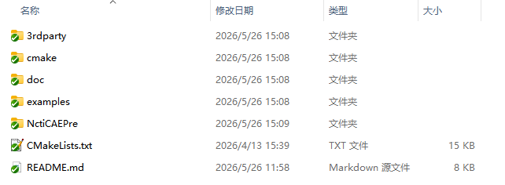
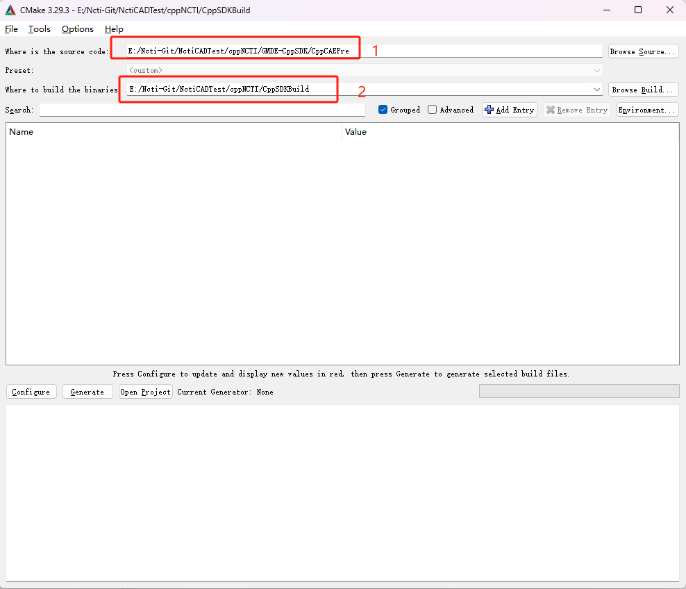
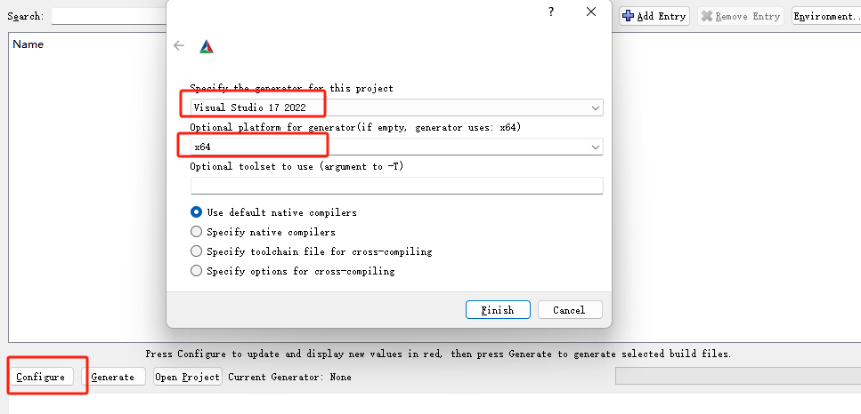
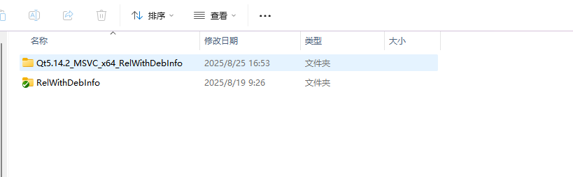

# CppCAEPre示例软件搭建教程

### 软件安装

本地安装Python3.8版本，安装时确保安装目录不存在中文，且勾选了“Add Python 3.8 to PATH”选项.

安装3.24版本以上的Cmake软件，如cmake-3.29.3-windows-x86_64.msi

安装Visual Studio2022，工作负荷选择”使用C++的桌面开发”，如图一所示

安装qt5.14.2，安装时需登录账号，并勾选msvc2017_64，如图二所示





### Cmake配置项目

#### 目录结构



CppCAEPre目录结构

```
├── CppCAEPre
│ ├── NctiCAEPre
│ │ ├── Code
│ │ │ ├── ncti_qt_cae_pre
│ │ │ ├── ncti_qt_launcher
│ │ │ ├── ncti_qt_pubfun
│ │ │ ├── ncti_qt_script_edit
│ │ │ ├── ncti_qt_uioption
│ │ ├── Inc
│ │ │ ├── ncti_qt_cae_pre
│ │ │ ├── ncti_qt_launcher
│ │ │ ├── ncti_qt_pubfun
│ │ │ ├── ncti_qt_script_edit
│ │ │ ├── ncti_qt_uioption
│ ├── doc	#文档资料
│ ├── cmake	#cmake函数文件
│ ├── 3rdparty	#第三方库
│ ├── examples	#示例
│ ├── CMakeLists.txt
```

注：CppCAEPre包含NctiCAEPre开源代码、example示例Demo、第三方库、文档说明、cmake函数文件,以及这个项目的cmake配置文件。

#### CMakeList.txt配置

如图三，打开Cmake软件，1处为源码路径，输入CppCAEPre下的CMakeLists.txt所在目录；2处为cmake输出目录，需自己新建一个文件夹。

点击下方“Configure”，选择“Visual Studio 17 2022”和“x64”，然后完成

会弹出“Error ”对话框，需要输入QT_DIR和QT5_DIR，均输入QT5.14.2 lib所在目录，例如：“D:\Qt5.14.2\5.14.2\msvc2017_64\lib\cmake\Qt5”

下方输出“Configuring done”表示成功，然后点击“Generate”，输出“Generating done”配置完成。

点击“Open Project”，打开Visual Studio 2022





### Visual Studio编译

更改配置类型为“RelWithDebInfo”，如图6

点击“生成解决方案”进行编译

编译成功后，打开“SDK”目录，将“RelWithDebInfo”里的内容复制进”Qt5.14.2_MSVC_x64_RelWithDebInfo”目录，如图7

打开Qt5.14.2安装目录，如“D:\Qt5.14.2\5.14.2\msvc2017_64\bin”，鼠标右键->在终端打开，进入PowerShell，输入指令”.\windeployqt.exe  YOUR_PATH\ncti_qt_cae_pre.exe”，YOUR_PATH自行修改为图7“Qt5.14.2_MSVC_x64_RelWithDebInfo”所在目录，然后回车。

将授权文件“gmde.lic”复制进图7“Qt5.14.2_MSVC_x64_RelWithDebInfo”所在目录

此时已经完成示例软件搭建的配置，返回Visual Studio点击“本地Windows调试器”（如图8）或者双击“ncti_qt_cae_pre.exe”即可启动软件。





