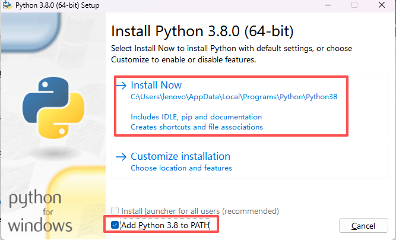
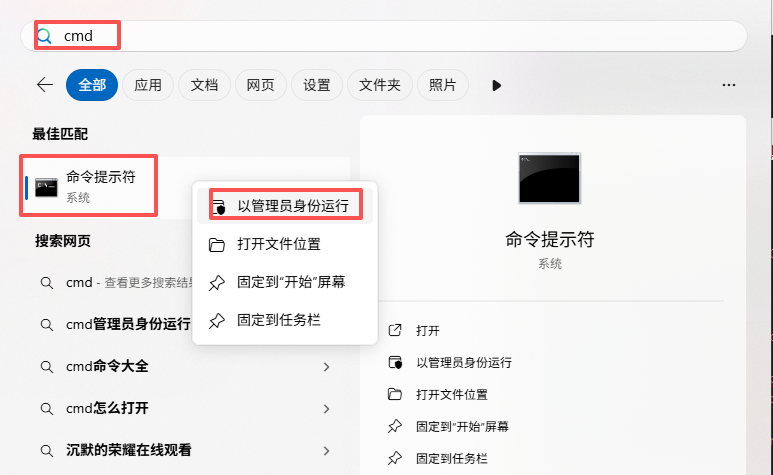
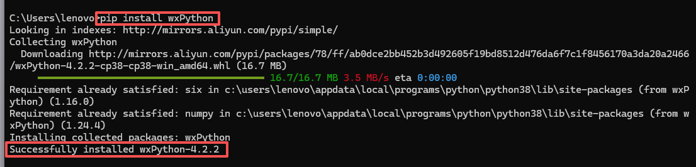

# PyCAEPre搭建教程

说明：简版教程只需一个python文件即可实现从0到1搭建PythonCAE前处理程序

本教程示例文件已放至：YHCAEPre\PyCAEPre\sample\PyGMDE_Sample.py

从第2步开始是该python文件从上到下逐一讲解。

## 1.环境搭建

本地安装Python3.8版本，安装时确保勾选了“Add Python 3.8 to PATH”选项.



安装一款Python编辑器，如Visual Studio Code、PyCharm.

以管理员权限打开命令提示符：



然后执行以下指令：

```python
pip install --upgrade pip
pip install wxPython
```

运行结束检查是否安装成功，注意wxPython版本需要4.1及以上：



## 2.新建一个.py文件，作为主文件

## 3.主文件导入系统库和界面库

```python
import sys
import ctypes
import importlib
import os
import sys
from functools import partial

from wx.svg import SVGimage
import wx
import wx.ribbon as RB
import wx.aui as aui
```

## 4.主文件导入底层引擎库以及导入插件，dllpath更改为SDK所在的路径

```python
#底层动态链接库路径
dllpath = r"YOURPATH/SDK"
if not os.path.exists(dllpath):
current_dir = os.path.dirname(os.path.abspath(__file__))
dllpath = current_dir+"/"+dllpath
sys.path.insert(0, dllpath)
# 基于dllpath，添加OCC内核引擎路径
os.add_dll_directory(dllpath + "/OCC")

# 添加插件
# 命令插件
ctypes.CDLL(dllpath + "/" + "ncti_command.dll")
# OCC相关插件
ctypes.CDLL(dllpath + "/" + "ncti_occ_plugin.dll")
ctypes.CDLL(dllpath + "/" + "ncti_doc_occ.dll")
# 渲染插件
ctypes.CDLL(dllpath + "/" + "ncti_render_vulkan.dll")
# GMsh插件
ctypes.CDLL(dllpath + "/" + "ncti_gmsh_plugin.dll")
#导入ncti_python模块
NCTI = importlib.import_module("ncti_python")
NCTI.Init(dllpath)
```

## 5.声明窗口类MainWindow

```python
#窗口类
class MainWindow(wx.Frame):
def __init__(self):
super().__init__(None, title='Python前处理', size=(1280, 960))
# 关联NCTI对象和实例化doc对象
		 self.NCTI = NCTI
self.doc = NCTI.Document()
		 self._init_views()
		 self.Center()
```

## 6.初始化Ribbon页

```python
# MainWindow类函数，初始化Ribbon页
def _initRibbon(self):
self.ribbon = RB.RibbonBar(self, style=RB.RIBBON_BAR_DEFAULT_STYLE)
self._initRibbonPageFile()
self.ribbon.Realize()

# MainWindow类函数，添加按钮，注意图标路径需正确
def _initRibbonPageFile(self):
        filePage = RB.RibbonPage(self.ribbon, label='Sample')
        asmPanel = RB.RibbonPanel(filePage, label='基础功能',style=RB.RIBBON_PANEL_NO_AUTO_MINIMISE)
        asmBar = RB.RibbonButtonBar(asmPanel)
        self._add_ribbon_bar_button(asmBar, "./resources/ribbon/doc_part", '创建零件', '创建新的零件', on_new_button_click)
        self._add_ribbon_bar_button(asmBar, "./resources/Geometry/box", '长方体', '创建长方体', on_create_box_button_click)
        self._add_ribbon_bar_button(asmBar, "./resources/ribbon/undo", '撤回', '', on_undo_button_click)
        self._add_ribbon_bar_button(asmBar, "./resources/ribbon/redo", '重做', '', on_redo_button_click)

# MainWindow类函数，绑定按钮函数
def _add_ribbon_bar_button(self, bar, name, title, tips, handle=None, param=None):
        id = wx.NewIdRef()
        wx.ART_FILE_OPEN
        bar.AddButton(id,  title,  self.svg2bmp(f"{name}.svg"), help_string=tips)
        if handle is not None:
            if param is not None:
                self.Bind(RB.EVT_RIBBONBUTTONBAR_CLICKED, partial(handle, self, param), id=id)
            else:
                self.Bind(RB.EVT_RIBBONBUTTONBAR_CLICKED, partial(handle,self), id=id)
        return id


# MainWindow类函数
def svg2bmp(self,svg_path, size=(24, 24)):
        svg = SVGimage.CreateFromFile(svg_path)
        # 返回 wx.Bitmap，无需任何 DC
        return svg.ConvertToScaledBitmap(wx.Size(*size))

```

## 7.初始化视窗

```python
# MainWindow类函数，初始化视窗
    def _init_views(self):
        # ---------- 1. 创建 RibbonBar ----------
        self._initRibbon()
        # ---------- 2. 主内容区 ----------
        self.center_panel = wx.Panel(self)
        # 渲染窗口
        self.cad_view = RenderView(self.center_panel, self.NCTI, self.doc)
        self.hwnd = self.cad_view.GetHandle()
        # 日志窗口
        self.log_view = LogView(self.center_panel)
        self.log_view.enableLog()
        # ---------- 3. 布局 ----------
        # 顶部 Sizer 只放 Ribbon
        main_sz = wx.BoxSizer(wx.VERTICAL)
        main_sz.Add(self.ribbon, 0, wx.EXPAND)
        # 中心区域就是 center_panel
        main_sz.Add(self.center_panel, 1, wx.EXPAND)
        self.SetSizer(main_sz)
        self.Layout()
        # AuiManager 只管理 center_panel 里的子控件
        self.mgr = aui.AuiManager(self.center_panel, aui.AUI_MGR_DEFAULT&~aui.AUI_MGR_ALLOW_FLOATING&~aui.AUI_MGR_TRANSPARENT_DRAG)   # 关键点：manager 的 parent 是 center_panel
        self.mgr.AddPane(self.cad_view,aui.AuiPaneInfo().CenterPane().Caption("视图").CloseButton(False))
        self.mgr.AddPane(self.log_view,aui.AuiPaneInfo().Bottom().Caption("日志输出").BestSize(-1, 150).Floatable(False).CloseButton(False))
        self.mgr.Update()
        self.Bind(aui.EVT_AUI_RENDER, self.cad_view.updateView)
```

## 8.增加渲染窗口类和日志输出窗口类

```python
#渲染窗口类
class RenderView(wx.Panel):
    def __init__(self, parent, ncti, doc):
        super().__init__(parent)
        self.doc = doc
        self.NCTI = ncti
        self.view = None
        self.Bind(wx.EVT_SIZE, self.updateView)

    def updateView(self, event=None):
        if self.view  == None:
            return
        if event != None:
            event.Skip()
        size = self.Size
        self.view.SetGeometry(0, 0, size.width, size.height)
        wx.CallLater(50, self.doc.Update)

    def updateDoc(self, ncti, doc, view):
        self.doc = doc
        self.NCTI = ncti
        self.view = view
#日志窗口类
class LogView(wx.TextCtrl):
    def __init__(self, parent):
        super().__init__(parent, style=wx.TE_READONLY | wx.TE_MULTILINE)
        self.SetBackgroundColour(wx.Colour(30, 30, 30))
        self.SetForegroundColour(wx.Colour(0, 255, 0))
        self._enableLog = False

    def Destroy(self):
        if self._enableLog:
            sys.stdout = sys.__stdout__
            sys.stderr = sys.__stderr__
        super().Destroy()

    def enableLog(self, enable=True):
        self._enableLog = enable
        if enable:
            sys.stdout = self
            sys.stderr = self
        else:
            sys.stdout = sys.__stdout__
            sys.stderr = sys.__stderr__

    def write(self, msg):               # 文件接口
        if not msg.endswith('\n'):
            msg += '\n'
        wx.CallAfter(self.AppendText, msg)

```

## 9.按钮关联函数

```python
#单独函数，不在类里
def on_new_button_click(mainWindow, event = None):
    if False == hasattr(mainWindow, 'doc'):
        return
    res  = mainWindow.doc.ReturnDialogData(-1, "创建零件文档", "几何引擎", ["OCC"], "网格引擎",["GMSH"])
    if len(res) > 0:
        mainWindow.doc.New(res[0][0], "", res[1][0])
        mainWindow.view = NCTI.View(mainWindow.doc.ID)
        mainWindow.view.CreateWindow(mainWindow.hwnd)
        mainWindow.view.SetWindowVis(True,mainWindow.doc.ID)
        mainWindow.doc.SetCreateGeGeom(1)  # 不生成平台对象（不生成会快）
        mainWindow.doc.Zoom()
        #调整视窗大小
        mainWindow.cad_view.updateDoc(mainWindow.NCTI,mainWindow.doc,mainWindow.view)
        mainWindow.cad_view.updateView()
        mainWindow.doc.Update()

#单独函数，不在类里
def on_create_box_button_click(mainWindow, event = None):
    mainWindow.doc.ResetCaseResult()
    length = 10.0
    width = 20.0
    height = 30.0
    pt = mainWindow.NCTI.Point(0, 0, 0)
    res = mainWindow.doc.ReturnDialogData(-1, "创建长方体参数", "长", length, "宽", width, "高", height, "顶点坐标", pt)
    if len(res) == 0 :
        print("用户取消了操作")
    elif res[0] <= 0.0 or res[1] <= 0.0 or res[2] <= 0.0 :
        print("请输入合理的长方体的长、宽和高")
    else :
        length = res[0]
        width = res[1]
        height = res[2]
        pt = res[3]
        mainWindow.doc.RunCommand("cmd_ncti_create_box", "", pt, length, width, height)
        mainWindow.doc.Zoom()

#单独函数，不在类里
def on_undo_button_click(mainWindow, event = None):
    mainWindow.doc.Undo()

#单独函数，不在类里
def on_redo_button_click(mainWindow, event = None):
    mainWindow.doc.Redo()
```

## 10.主函数实例化窗口类

```python
if __name__ == '__main__':
    app = wx.App(False)
    MainWindow().Show()
    app.MainLoop()
```

## 11.启动程序


## 12.更多开发教程支持

可访问在线开发教程：[https://opencax.cn/gmde/knowledge/index](https://opencax.cn/gmde/knowledge/index)。该教程平台汇集相关开发入门指引、接口调用示例、实战案例以及常见问题解答等内容，覆盖从基础上手到二次开发的学习资料，开发者可在线查阅学习，快速掌握平台开发能力。